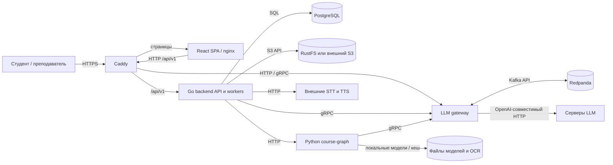

# Architecture Overview

Документ описывает архитектуру репозитория по состоянию на 2026-11-01. Основан на исходниках, миграциях, конфигурации Compose и контрактах; README используется для продуктовых решений и сверки. Это карта для навигации, а не подтверждение доступности развёрнутых сервисов или применённых миграций. При изменении архитектуры обновляйте документ вместе с кодом.

## 1. Project Structure

```text
ai_tutor/
├── services/
│   ├── backend/              # Go API, домен, фоновые задачи, SQL и миграции
│   │   ├── cmd/api/          # Точка входа, запуск и завершение процессов
│   │   ├── internal/app/     # Composition root, маршруты и связывание адаптеров
│   │   ├── internal/entities/# Доменные типы и чистые правила, в т. ч. экзамен
│   │   ├── internal/features/# Сценарии по предметным областям
│   │   └── internal/shared/  # HTTP, PostgreSQL, S3, безопасность, gateway
│   ├── frontend/             # React SPA, Vite, nginx runtime
│   │   ├── src/bootstrap/    # Провайдеры и сборка приложения
│   │   ├── src/routes/       # Маршруты TanStack Router
│   │   ├── src/pages/        # Композиции экранов
│   │   ├── src/widgets/      # Переиспользуемые блоки экранов
│   │   ├── src/features/     # Пользовательские действия
│   │   ├── src/entities/     # Предметные модели и API
│   │   └── src/shared/       # Транспорт, i18n и общие компоненты
│   ├── course-graph/         # Python: OCR, очистка, темы и построение графа
│   ├── llm-gateway/          # Go: очередь, маршрутизация и вызовы LLM
│   ├── shared/               # Protobuf-контракт и сгенерированные Go/Python stubs
│   ├── postgresql/, s3/      # Compose-конфигурация PostgreSQL и RustFS
│   └── caddy/                # HTTPS reverse proxy
├── api/                      # HTTP-контракты и фикстуры графа
├── documents/                # Спецификации, решения, исследования и материалы
├── tests/integration/        # Smoke-проверка полного стека
├── scripts/                  # Вспомогательные утилиты
├── .github/workflows/        # GitHub Actions
├── docker-compose*.yaml      # Основной стек, dev и внешний S3
├── dev.sh, up.ps1            # Локальный запуск
├── README.md                 # Продуктовые правила, решения и запуск
├── AGENTS.md                 # Обязательные правила работы в репозитории
└── architecture.md           # Этот документ
```

В backend feature обычно содержит `application` (сценарии и порты), `infrastructure` (адаптеры) и `transport/http` (HTTP). Связывание происходит в `internal/app`; SQL-исходники и goose-миграции находятся в `internal/shared/postgres/`, `sqlcgen` генерируется. Frontend следует Feature-Sliced Design: `bootstrap → pages → widgets → features → entities → shared`; `routes` — тонкий реестр, `routeTree.gen.ts` генерируется.

## 2. High-Level System Diagram



Caddy направляет `/api/v1` в backend, `/llm-gateway` и gRPC gateway — в gateway, остальные запросы — во frontend; Swagger доступен при соответствующем профиле. `course-graph` — внутренний сервис, Caddy его не публикует. Схема показывает маршруты конфигурации, а не гарантирует, что внешние модели доступны.

Основные потоки:

1. **Подготовка курса.** Преподаватель загружает материалы; backend сохраняет метаданные и задания в PostgreSQL, файлы — в S3. Фоновые workers вызывают course-graph для OCR и очистки, gateway — для перевода и других LLM-операций. Backend оркестрирует сборку и публикацию графа из материалов либо импортированной карты компетенций; Python выполняет вычислительные этапы, но не пишет в БД или S3.
2. **Экзамен `/exam`.** Geek использует опубликованный граф, ведёт диагностическую сессию и обращается к LLM через gateway. Код домена определяет обход, статусы и оценку A–D; модель поставляет данные оценки. Голос проходит через backend и внешние STT/TTS.
3. **Обучение `/learn`.** Отдельные сценарии охватывают карту компетенций, банк и генерацию заданий, варианты, диагностику, тренировку, обратную связь и учебные планы. Курсы и авторизация общие с экзаменом, но доменные сценарии и таблицы обучения выделены отдельно.
4. **LLM.** Backend и course-graph используют общий protobuf/gRPC-контракт. Gateway принимает также HTTP, сохраняет задания и состояние через Redpanda, планирует вызовы по сложности и профилю и обращается к настроенным upstream-инстансам. Клиент не выбирает модель напрямую.

## 3. Core Components

### 3.1. Frontend

**Название:** AI Tutor frontend. **Назначение:** вход, выбор режима, учебный и экзаменационный интерфейсы, управление курсами, материалами и картами. HTTP-клиенты живут рядом с предметными срезами; строки интерфейса проходят через i18n. **Технологии:** TypeScript, React, Vite, TanStack Router и Query, Radix Themes, React Flow, i18next. **Развёртывание:** Docker; в runtime статическую сборку отдаёт nginx, в dev работает Vite.

### 3.2. Backend Services

#### 3.2.1. Backend API

**Название:** `services/backend`. **Назначение:** авторизация и общие курсы; HTTP API `/auth`, `/exam`, `/learn`, `/voice`; управление материалами и графами, сессиями, оцениванием, тренировкой и аудио. Запускает workers OCR, очистки, графа и аудио; использует PostgreSQL, S3, course-graph, gateway и голосовые сервисы. **Технологии:** Go, стандартный HTTP server, pgx, goose, sqlc, AWS S3 SDK, gRPC. **Развёртывание:** контейнер Compose; точка входа `cmd/api`, композиция `internal/app/app.go` и `learning_composition.go`.

#### 3.2.2. Course graph

**Название:** `services/course-graph`. **Назначение:** преобразование документов в Markdown/OCR, очистка, извлечение тем, связи и сборка графа. API включает `/ocr/convert`, `/ocr/jobs/{id}`, `/clean`, `/topics/extract`, `/graph/links`, `/graph/build`, `/health` и `/ready/models`. OCR и модели используют локальный кеш; часть операций вызывает gateway. **Технологии:** Python, FastAPI, Docling, PyTorch, sentence-transformers, gRPC. **Развёртывание:** Compose с CPU/GPU-вариантами и volumes для кеша.

#### 3.2.3. LLM gateway

**Название:** `services/llm-gateway`. **Назначение:** единая точка вызова моделей, очередь и восстановление состояния, ограничение нагрузки и планирование по сложности и routing profile; HTTP и gRPC клиенты используют один сервис. Метрики очереди и инстансов выдаются на `/metrics`. **Технологии:** Go, gRPC/protobuf, franz-go, Redpanda и OpenAI-совместимый upstream HTTP API. **Развёртывание:** Docker Compose; конфигурация моделей и профилей в `config/dev.yaml`.

#### 3.2.4. Shared contracts

`services/shared` — не отдельный сервер, а общий модуль: `proto/llmgateway/v1/gateway.proto` и генерируемые Go/Python-клиенты. Он фиксирует границу gateway и потребителей; генерация и проверка совместимости находятся в `tools/`.

## 4. Data Stores

### 4.1. PostgreSQL

**Тип:** PostgreSQL 18 в локальном Compose. **Назначение:** основное постоянное состояние и задания backend. Ключевые группы таблиц: `users`, `auth_sessions`, `access_tokens`, `refresh_tokens`, `subjects`, `subject_materials`; `material_ocr_jobs`, `material_cleaning_jobs`, `course_graph_jobs`, `course_graphs`, `course_graph_maps`; `geek_sessions`, `geek_requests`; таблицы `learning_*` для карты, заданий, вариантов, диагностики, тренировок, аудио и планов. Актуальная схема определяется последовательностью миграций `services/backend/internal/shared/postgres/migrations/`, включая переименования; миграции применяет backend при старте. Очереди обработки материалов используют захват заданий с блокировкой и lease.

### 4.2. Объектное хранилище

**Тип:** S3-совместимое; локально RustFS, предусмотрен override для внешнего S3. **Назначение:** исходные и обработанные материалы, аудио и другие объектные данные; ссылки и состояние находятся в PostgreSQL. Данные локального RustFS сохраняются в volume.

### 4.3. Redpanda и локальный кеш

**Redpanda:** Kafka-совместимое постоянное хранилище очереди и состояния LLM gateway; темы настроены в YAML, данные находятся в volume. Это очередь gateway, а не общая шина событий всех сервисов. **Course-graph:** отдельные volumes хранят файлы моделей и кеш OCR; это вычислительный кеш, не основной источник состояния курсов.

## 5. External Integrations / APIs

| Интеграция | Назначение и способ подключения |
| --- | --- |
| Серверы LLM | Настраиваемые OpenAI-совместимые HTTP upstream через gateway; список и параметры — в `services/llm-gateway/config/dev.yaml`. |
| STT и TTS | Backend вызывает отдельные HTTP endpoints распознавания и синтеза речи; адреса заданы в `services/backend/config/dev.yaml`. Браузерный TTS не используется. |
| S3 API | Backend использует AWS SDK для RustFS или внешнего совместимого хранилища. |
| Модели OCR и embeddings | Course-graph использует Docling и локальный runtime моделей; файлы могут загружаться и кешироваться при подготовке окружения. |

Внутренние контракты: `api/openapi.yaml` для HTTP backend, `api/course-graph.yaml` для Python-сервиса, `gateway.proto` для gRPC. Метка `implemented` в OpenAPI означает подключённую операцию, `planned` — проектируемую.

## 6. Deployment & Infrastructure

**Провайдер:** конкретное облако не зафиксировано. В репозитории описан локальный Docker Compose, а не отдельный production deployment. Основной стек включает Caddy, frontend, API, PostgreSQL, RustFS, course-graph, gateway и Redpanda; отдельные Compose-файлы сервисов и внешнего S3 позволяют менять окружение. `docker-compose.dev.yaml` добавляет watchers и монтирование исходников. Caddy использует локально подготовленные TLS-сертификаты; Swagger и observability включаются профилями.

**CI/CD:** GitHub Actions проверяет изменённые сервисы, генерацию контрактов, Compose, тесты, сборку образов и HTTPS stack smoke/E2E. Автоматическое развёртывание в workflow не описано. **Наблюдаемость:** структурированные логи backend, метрики gateway; Prometheus и Grafana с готовым dashboard доступны через профиль observability. `/health` backend проверяет сам API и PostgreSQL, но не все внешние зависимости.

## 7. Security Considerations

- Аутентификация — серверные сессии с access/refresh cookies; пароли хешируются Argon2id. Cookies имеют `Secure`, `HttpOnly`, `SameSite=Lax`; у admin и студенческого портала отдельные имена cookies.
- Защищённые HTTP-маршруты получают principal из сессии; проверки роли, владельца и доступа к курсу находятся в сценариях и соответствующих middleware. Наличие интерфейса или маршрута само по себе не означает права доступа.
- Снаружи в локальном стеке используется HTTPS через Caddy. Внутренние соединения и внешние STT/TTS/LLM зависят от конфигурации; не следует считать их автоматически зашифрованными. Шифрование данных в хранилищах конфигурацией репозитория не подтверждено.
- Секреты PostgreSQL и S3 задаются локально через env; YAML сервисов содержит настройки приложения. По зафиксированному решению токены upstream-моделей пока могут находиться в gateway YAML. Gateway не должен логировать содержимое запросов и ответов моделей.
- Course-graph предназначен для внутренней сети. Доступные через Caddy маршруты gateway следует учитывать при настройке периметра; отдельная схема внешней авторизации gateway в этой конфигурации не показана.

## 8. Development & Testing Environment

Локальный запуск и требования — [README: запуск](README.md#запуск): `.env` на основе `.env.example`, Docker Compose, mkcert и `./dev.sh -d`. Настройки сервисов находятся в `services/*/config/dev.yaml`; значения подключения и секреты инфраструктуры — в env. Не удаляйте volumes без явного согласования.

| Слой | Проверки и инструменты |
| --- | --- |
| Backend | `go test -race ./... -count=1`, `go vet ./...`, `go build -o bin/api ./cmd/api`; DB-тестам нужен `TEST_DATABASE_URL`. |
| Frontend | `npm run format:check`, `npm run lint`, `npm run typecheck`, `npm test -- --run`, `npm run build`; Vitest, Testing Library, Playwright. |
| Course-graph | `uv run --locked --extra cpu --extra ocr python -m pytest tests`; pytest, CPU/GPU extras. |
| Gateway | `GOWORK=off go test -race ./... -count=1`, `go vet`, `go build`, проверка генерации OpenAPI; интеграционные тесты очереди требуют Redpanda. |
| Shared | `services/shared/tools/generate.sh --check` и `check-compat.sh <base-sha>` из корня. |

Команды сервисов выполняются из соответствующего каталога; полный перечень, генерация и дополнительные проверки приведены в корневом и локальных `AGENTS.md`. Контракты и сгенерированный код вручную не редактируются.

## 9. Future Considerations / Roadmap

- В экзаменационном контуре диалог тренировки остаётся будущим этапом; не путать с реализованными маршрутами тренировок `/learn`. Пакет преподавателя для Geek в HTTP-контракте обозначен как `planned`.
- В README зафиксировано отклонение интерфейса Geek от целевой синхронизации текста и итоговой карточки с озвучкой. Требуется сверить реализацию при исправлении.
- Для неизвестных видов материалов настраиваемые учебные роли остаются открытым продуктовым вопросом. Новые правила нельзя молча выбирать в коде.
- Качество и производительность полного конвейера на реальных материалах и доступность внешних моделей требуют отдельных фактических проверок; unit-тесты и health их не подтверждают.
- Исторические планы и результаты аудитов датированы; актуальные решения и состояние смотрите в README и контрактах, проверяя их по коду.

## 10. Project Identification

- **Название:** AI Tutor / AI-репетитор.
- **Репозиторий:** https://github.com/AskarKasimov/ai-tutor
- **Контакт/команда:** явно не указаны в репозитории; используйте владельцев репозитория.
- **Дата обновления:** 2026-11-01.

## 11. Glossary / Acronyms

- **Geek** — экзаменационный диалоговый сценарий диагностики знаний по графу курса.
- **КК / карта компетенций** — структурированное описание компетенций и результатов обучения; форматы и обработка отличаются в `/exam` и `/learn`.
- **ОР** — образовательный результат, единица карты компетенций обучения.
- **Граф курса** — темы или компетенции и связи между ними с источниками; используется экзаменационным сценарием.
- **OCR** — извлечение текста и структуры из документов; **STT** — распознавание речи; **TTS** — синтез речи.
- **LLM gateway** — сервис очереди и маршрутизации обращений к языковым моделям; **upstream** — настроенный сервер модели.
- **FSD** — Feature-Sliced Design, соглашение о слоях frontend; **DTO** — объект передачи данных; **gRPC** — RPC-протокол поверх protobuf.
