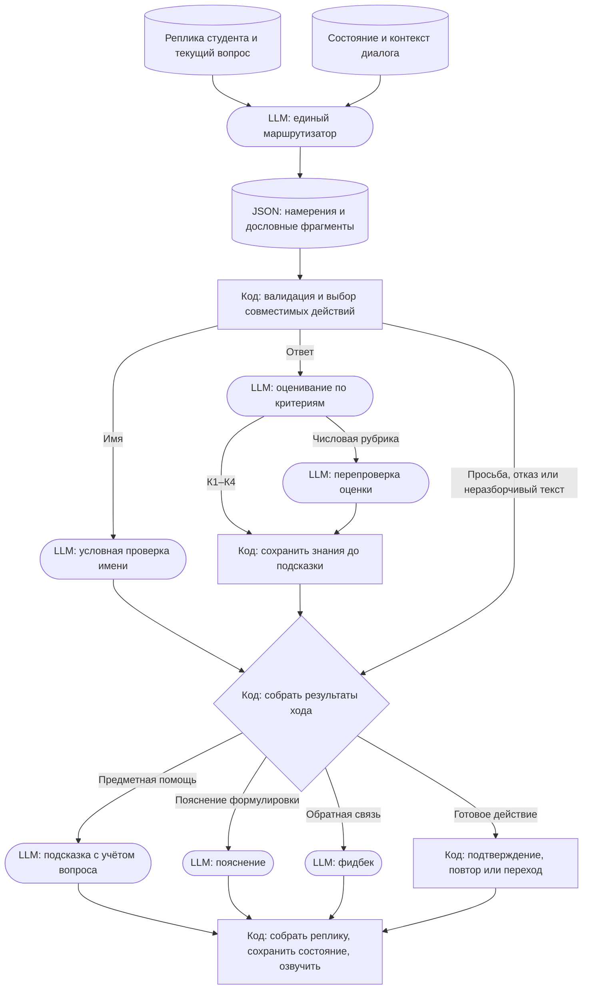

# Эксперимент: единый маршрутизатор реплик Geek

Статус: проектирование, новая архитектура ещё не реализована. Ветка `experiment/geek-unified-router` включает изменения PR #185 и актуальную документацию master. Эксперимент касается симуляции экзамена Geek.

## Зачем

Сейчас отдельный вызов модели распознаёт просьбу изменить имя, а затем маршрутизатор или оценщик повторно разбирает ту же реплику. Модель ошибочно приняла имя профессора из ответа студента за имя студента. Смешанные реплики с ответом и просьбой о подсказке тоже требуют корректного сохранения обеих частей.

## Предлагаемый поток

LLM возвращает несколько независимых признаков и точные цитаты, оставляя нерелевантный текст без метки. Код проверяет схему и соответствие цитат, но сама цитата не доказывает намерение. Имя студента подтверждается отдельно только при кандидате; имя преподавателя или персонажа не должно менять обращение. Имя как строка требуется вместе с булевыми признаками.

При ответе и имени сохранить имя и оценить ответ. При частичном ответе и «остальное не знаю» сохранить сказанное. При ответе и просьбе о помощи сначала зафиксировать самостоятельное содержание, затем дать подсказку и учесть её в последующем ходе. Короткий содержательный ответ направлять оценщику. Пояснение формулировки не снижает оценку; предметная подсказка считается помощью. Не считать отказом от вопроса слова «не знаю» внутри просьбы о помощи. Не выдавать готовое решение в подсказке.

Предпочтительна нейтральная форма обращения. Хранить подтверждённое имя, состояние вопроса, ранее показанное содержание и полученную помощь. Свободное запоминание моделью не согласовано.

## Как продолжить

Изучить действующий поток `services/backend/internal/features/geek/application/service.go` и `infrastructure/llm/{name_intent,rubric_router,rubric,support}.go`, правила backend и актуальный README. Реализовать единый маршрутизатор через LLM gateway, исключить дублирующие вызовы и проверить существующие пути с числовой и нечисловой рубрикой, сохранённые сессии и смешанные реплики. Оценивание, фидбек, обход графа и голосовой интерфейс сохранить в соответствии с принятыми правилами.

Проверить примеры с именем персонажа, представлением, именем плюс ответом, ответом плюс подсказкой, частичным ответом и незнанием, коротким содержательным ответом, посторонним диалогом и противоречивым/невалидным JSON. Сравнить качество и время до первого звука с прежним потоком на живых примерах, отдельно указать недоступные зависимости. Не считать схему выполненной реализацией до проверки.

Стенд и загруженные карты пользователь просил сохранять. Не удалять базы и контейнеры без нового указания. Ветка PR #185 остаётся отдельной от эксперимента.
