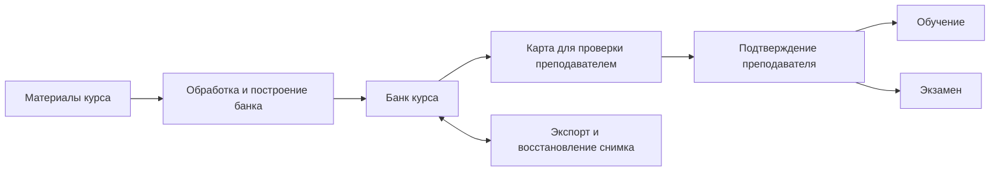

# Единый банк курса — черновик для обсуждения

## Зачем

Система готовит содержание курса по загруженным материалам. Сегодня обучение и экзамен используют отдельные представления и хранилища: учебную карту компетенций и экзаменационный граф. Требуется единый банк курса, подготовленный из материалов и используемый обоими режимами.

Карта компетенций — человекочитаемое представление банка. Преподаватель использует её для проверки подготовленного содержания, а разработчик — для восстановления dev-окружения без повторной генерации курса.

## Согласованные требования

- Основной производственный источник содержания — материалы курса.
- Обучение и экзамен используют один банк курса. Их правила диагностики, оценивания и состояние сессий остаются отдельными; перенос прогресса между режимами не согласован.
- После построения преподаватель проверяет карту и явно подтверждает банк. До подтверждения банк недоступен студентам.
- При обнаружении ошибки преподаватель может отправить банк на полную перегенерацию. Редактирование карты и загрузка исправлений пока не входят в объём.
- При запуске перегенерации прежний банк перестаёт быть доступным студентам. Уже начатые диагностика и обучение принудительно завершаются; их состояние сохраняется со статусом «прервано ошибкой».
- Снимок должен восстанавливать готовый банк целиком, включая сгенерированные задания и критерии, без повторных вызовов LLM для подготовки курса. Это не отменяет вызовы модели в ходе занятий и экзамена.

## Предлагаемая архитектура

Предлагается сохранить существующие границы сервисов: `course-graph` обрабатывает материалы и готовит содержание, backend управляет заданиями обработки, хранением, проверкой и публикацией; LLM вызывается через gateway. Основное хранилище банка — PostgreSQL, файлы материалов и другие необходимые файловые артефакты — S3. Размещение элементов банка в таблицах или в составе снимка требует отдельного решения.

Единый банк — источник содержания для двух режимов, а не требование свести их алгоритмы к одному. Для обучения и экзамена могут формироваться разные представления из одной опубликованной версии банка.

## Состав банка: предложение для обсуждения

Состав выведен из существующих потребителей; название и гранулярность элементов ещё нужно согласовать на реальном курсе.

| Данные | Зачем нужны |
| --- | --- |
| Структура курса: компетенции, составляющие, образовательные результаты или их согласованные аналоги | Группировка, выбор заданий, план и расчёт результата |
| Учебное содержание и ссылки на фрагменты материалов | Контекст экзамена и основа обучения; проверка происхождения содержания |
| Связи пререквизитов | Переходы экзамена и возможное использование при обучении |
| Задания, эталоны и критерии | Диагностика и оценивание в обоих режимах |
| Данные для отбора заданий | Таксономия, важность и признак включения в диагностику требуются текущему учебному алгоритму |
| Метаданные версии и источников | Проверка и воспроизведение опубликованного содержания |

Поля заданий и форматы критериев должны покрывать реальные потребности обоих режимов. Не предполагается автоматически считать любую извлечённую тему одним образовательным результатом: текущая тема может содержать несколько знаний (`provides`). Необязательные поля, в том числе плановое время, следует определить по фактическим потребностям сценариев, а не требовать без обоснования.

## Сценарий подготовки

1. Преподаватель загружает материалы курса.
2. Система обрабатывает материалы и строит единый банк с заданиями, критериями и связями.
3. Преподаватель просматривает человекочитаемую карту банка.
4. Если содержание подходит, преподаватель подтверждает банк; после этого он может использоваться студентами с учётом готовности соответствующего режима.
5. Если обнаружена ошибка, преподаватель запускает полную перегенерацию и проверяет новый результат.

При перегенерации старый банк недоступен студентам, а начатые диагностика и обучение прерываются ошибкой с сохранением состояния. Порядок восстановления после сбоя генерации и возможность вернуть прежний банк пока не определены.

## Карта и снимок

Карта должна быть понятна преподавателю и показывать содержание, необходимое для его проверки. Для восстановления dev-окружения экспорт должен сохранять полный банк, включая данные и подготовленные формулировки, необходимые для старта обоих режимов, а также связи и метаданные источников.

Формат снимка и соотношение человекочитаемой карты с полным экспортом пока не выбраны: это может быть один файл или комплект файлов. Если требуется восстановить открытие исходных PDF после сброса S3, нужны также сами файлы либо определённый способ их восстановления; одних ссылок на удалённые объекты недостаточно.

Импорт снимка не должен запускать LLM-подготовку банка. Требуется проверить восстановление структуры, заданий, критериев, связей и готовности режимов после экспорта и повторного импорта.

## Отличия от текущей реализации

- Сейчас обучение импортирует собственную карту и хранит собственные данные; экзамен использует опубликованный граф из материалов или карты. Описание текущего состояния — в [README backend](../services/backend/README.md#бд-и-импорт).
- Граф из материалов уже содержит темы, тексты, вопросы, источники и пререквизиты, но не формирует всю структуру и метаданные, которые требует текущий выбор учебных заданий. См. [course-graph](../services/course-graph/README.md#конвейер-обработки) и [учебную модель](../services/backend/internal/entities/competencymap/model.go).
- Текущий экзаменационный импорт карты запускает подготовку вопросов; он не является полным восстановлением подготовленного банка без LLM.
- [Корневой README](../README.md#обучение-по-карте-компетенций) сейчас описывает загрузку учебной карты преподавателем и независимые данные режимов. После согласования изменения поведения потребуется обновить действующую документацию и затронутые контракты.

## Границы и открытые вопросы для лида

- Какой уровень структуры нужен обоим режимам: остаются ли компетенция → составляющая → ОР обязательными или учебный алгоритм следует адаптировать к темам из материалов?
- Как получать таксономию, важность, пригодность к диагностике, эталоны и критерии из материалов и как проверять качество результата?
- Какие связи являются действительными пререквизитами и как каждый режим может их использовать? Сохраняется ли текущее правило экзамена об автоматическом зачёте пререквизитов?
- Как преподаватель видит источники, ошибки и полноту банка при проверке? Как определяется готовность каждого режима?
- Что происходит при сбое генерации, может ли преподаватель вернуть прежний банк и как повторить подготовку?
- Какую версию содержания сохраняют завершённые и прерванные сессии, и какие результаты доступны студенту?
- Должен ли снимок включать файлы материалов и аудио или достаточно данных банка с отдельным восстановлением файлов? Какой формат остаётся удобным для преподавателя и пригодным для точного импорта?
- Как перенести существующие карты, графы и результаты, не меняя незаметно правила обучения и экзамена?

## Проверка результата реализации

- По материалам готовится банк, содержащий данные для обоих режимов; его содержание и связи можно проверить по источникам.
- До подтверждения преподавателем студент не может начать работу с новым банком; после подтверждения доступ определяется готовностью режима.
- Запуск полной перегенерации делает прежний банк недоступным; начатые диагностика и обучение сохраняются как прерванные ошибкой.
- Экспорт и повторный импорт восстанавливают согласованный состав банка и готовность обоих режимов без вызовов LLM для подготовки курса. Состав файлов и точные проверки равенства уточняются после выбора формата.
- Завершённые результаты остаются доступными с содержанием, необходимым для их объяснения; детали хранения и отображения нужно согласовать.
